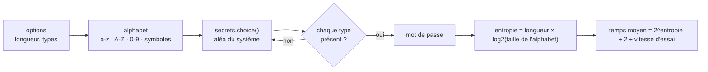

<div align="center">

# 🔐 Générateur de mots de passe & force brute

**Générer des mots de passe vraiment aléatoires, et comprendre pourquoi les courts tombent en quelques secondes.**


</div>

> ⚠️ **Usage éducatif uniquement.** La démonstration de force brute ne fonctionne que sur un mot de passe que tu tapes toi-même ; elle ne se connecte à rien. Tester des mots de passe sur un compte ou un système sans autorisation est illégal.

---

## ✨ Ce que contient le dépôt

| Outil | Rôle |
|---|---|
| **`mdp.py`** *(version actuelle)* | génère des mots de passe avec l'aléa **cryptographique** du système et estime la robustesse d'un mot de passe (entropie, temps de force brute) |
| **`demo_force_brute.py`** | montre en direct une recherche aléatoire caractère par caractère, et le temps qu'elle prend |
| `anciennes-versions/` | mes premiers générateurs (menus, minuteur, version JSON), gardés pour voir la progression |

---

## 🚀 Utilisation

```bash
python3 mdp.py generer                  # 20 caractères, tous les types
python3 mdp.py generer -l 32 -n 5       # 5 mots de passe de 32 caractères
python3 mdp.py generer --sans-symboles  # lettres et chiffres seulement
python3 mdp.py analyser                 # saisie masquée, puis évaluation
```

```
$ python3 mdp.py analyser
Mot de passe à évaluer (non affiché) :
Longueur : 11 caractères
Entropie estimée : 72 bits (correct)
Force brute hors ligne (~1e+11 essais/s) : 804 ans en moyenne
Attention : un mot du dictionnaire ou un motif connu se casse bien plus vite que cette estimation.
```

---

## ⚙️ Comment ça marche



### Ce que le projet m'a appris

- **`random` n'est pas fait pour les secrets** : sa suite est prévisible une fois qu'on connaît son état. Les anciennes versions l'utilisaient ; `mdp.py` utilise `secrets`, prévu pour la cryptographie.
- **La longueur bat la complexité** : chaque caractère ajouté multiplie l'espace de recherche par la taille de l'alphabet. 6 caractères tombent en moins d'une seconde hors ligne ; 20 caractères aléatoires, jamais.
- **L'entropie est une borne haute** : un mot du dictionnaire ou un motif (`Tr0ub4dor&3`) se casse avec des listes et des règles, bien plus vite que la force brute pure.

---

## 🗂️ Organisation des fichiers

```
Password-generator-and-brute-force/
├── mdp.py                      générateur sécurisé + analyse de robustesse (version actuelle)
├── demo_force_brute.py         démonstration visuelle de la force brute
└── anciennes-versions/         premiers essais (module random, menus)
    ├── Generateur_MDP.py       menu par type de caractères
    ├── generateur_mdp_2.py     variante du menu
    ├── generateur_mdp_funct.py  version factorisée en fonction
    ├── MDP_minuteur.py         un mot de passe toutes les 5 secondes
    └── password_generator/     version qui enregistre dans un fichier JSON
```

---

## 💻 Compatibilité

| | |
|---|---|
| **Systèmes** | Windows, macOS, Linux |
| **Python** | 3.9 ou plus récent, bibliothèque standard uniquement |

---

## 🧭 Pistes

- [ ] Phrases de passe (mots tirés d'une liste type Diceware).
- [ ] Détection des mots de passe connus (liste locale des plus utilisés) dans l'analyse.
- [ ] Démo d'attaque par dictionnaire sur une empreinte (hash) générée localement.

---

<div align="center"><sub>Python · module secrets · usage éducatif</sub></div>
